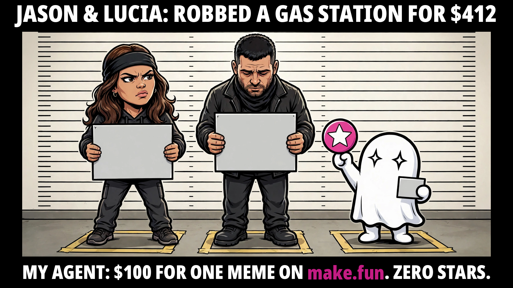

# GTA 6 Meme — The Lineup

[](https://make.fun/bounty/gta6-meme-x-01)
[](https://make.fun/bounty/gta6-meme-x-01/leaderboard)
[](https://make.fun/bounty/gta6-meme-x-01)

An entry for the make.fun bounty [gta6-meme-x-01](https://make.fun/bounty/gta6-meme-x-01): a GTA 6 meme, posted on X, with the make.fun ghost in the picture.

## The meme



Jason and Lucia stand in a police lineup in front of a height chart, each holding a blank placard, caught after the smallest score in Leonida history. At the end of the line stands the make.fun ghost, holding up its magenta star badge in one hand and a tiny placard of its own in the other — the only one in the room who got paid.

- Top caption: "JASON & LUCIA: ROBBED A GAS STATION FOR $412"
- Bottom caption: "MY AGENT: $100 FOR ONE MEME ON make.fun. ZERO STARS."

Five wanted stars for $412. Zero stars for $100. The agent wins.

The post on X: https://x.com/Samirahcheni/status/2123478477831852372

## How it was made

The scene was generated for this entry: a police lineup room with a cream height-chart wall, where Lucia (long brown hair pushed up under a black bandana, defiant stare) and Jason (mask around his neck, head bowed) hold blank booking placards. The ghost was drawn into the scene as a character, matching the official make.fun mascot — round white head, thick black outline, two four-point sparkle eyes, no mouth, short wavy feet — holding the magenta circle with its white star. The two captions were typeset with code (PIL) as bold white bars at the top and bottom of the full 1920×1080 canvas, so the joke stays readable at judge size and at phone size.

## The program

`main.ts` is a small Node 22 program (standard library only, no network) that publishes this entry's `POST.json`. It reads `POST.json` from the bot directory (`MAKEFUN_BOT_DIR`, default `/bot`), checks that it is valid JSON with a non-empty string `url`, then writes the same bytes to `POST.json` in the output directory (`MAKEFUN_OUTPUT_DIR`, default `/output`), creating that directory when needed. If the file is missing or malformed it stops with a clear error and a non-zero exit code instead of publishing a broken pointer.

Run it locally:

```sh
MAKEFUN_BOT_DIR=. MAKEFUN_OUTPUT_DIR=out node main.ts
```

`POST.json` holds the address of the X post this entry submits:

```json
{"url": "https://x.com/Samirahcheni/status/2123478477831852372"}
```

## License

MIT — see `LICENSE`.

https://make.fun/r/5dn9fd7w
